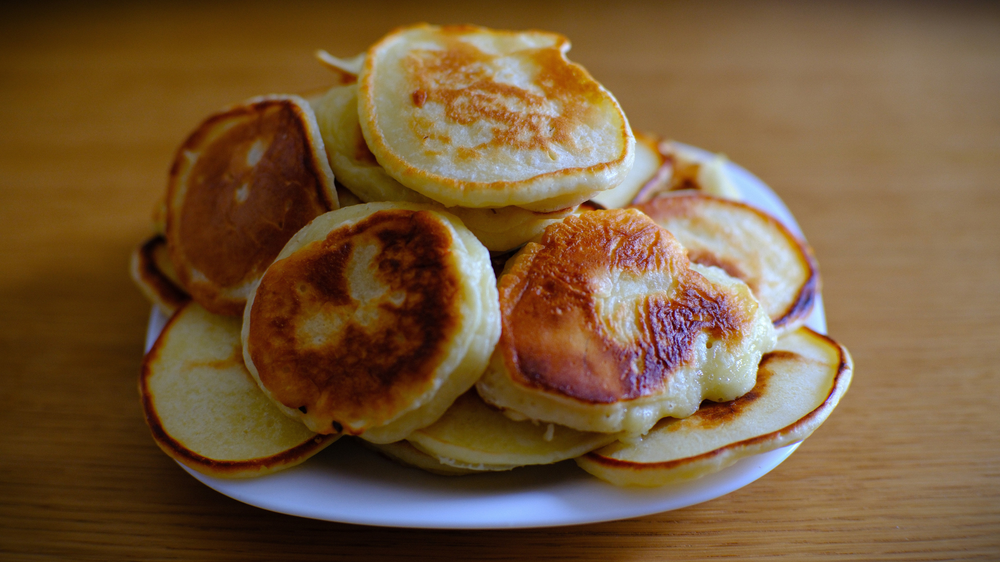

---
tags:
  - 15 минут
  - На двоих
  - Миксер
description: Сегодня готовим пышные оладушки на кефире с румяной корочкой. Главный секрет -- все продукты надо достать и подготовить заранее, они должны быть теплые.
---
# Оладушки на кефире

<figure markdown="span">
  
  <figcaption>Оладушки</figcaption>
</figure>

Сегодня готовим пышные оладушки на кефире с румяной корочкой. Главный секрет -- все продукты надо достать и подготовить заранее, они должны быть теплые.

## Инвентарь

- Миксер или венчик

## Ингредиенты

- Кефир 250 г
- Яйцо 1 шт
- Мука 220-240 г
- Сахар 1 ч л
- Соль 1/4 ч л
- Сода 1/4 ч л
- Масло растительное для жарки

## Способ приготовления

1. Заранее достань продукты из холодильника. Тесто из холодных продуктов не поднимется.
2. В миске смешай кефир, яйцо и соль. Постепенно вмешивай сахар.
3. Добавь просеянную муку, перемешай венчиком до однородного густого теста без комочков.
4. Добавь соду. Дополнительно гасить не надо, кислота кефира сделает всё сама.
5. Оставь тесто на 5-10 минут. После этого больше его не перемешивай, чтобы оладушки получились пышными.
6. Разогрей сковороду с небольшим количеством растительного масла на среднем огне.
7. Выкладывай тесто столовой ложкой и жарь оладушки по 2-3 минуты с каждой стороны до золотистой корочки. Если все сделано правильно, то можешь наблюдать, как они при жарке увеличиваются в размере.
8. Готовые оладушки переложи на бумажное полотенце, чтобы убрать лишнее масло, и подавай горячими.

К оладьям отлично подойдет варенье, сахар, мед, сгущеное молоко. при подаче можно добавить ягоды или фрукты.

Приятного аппетита!