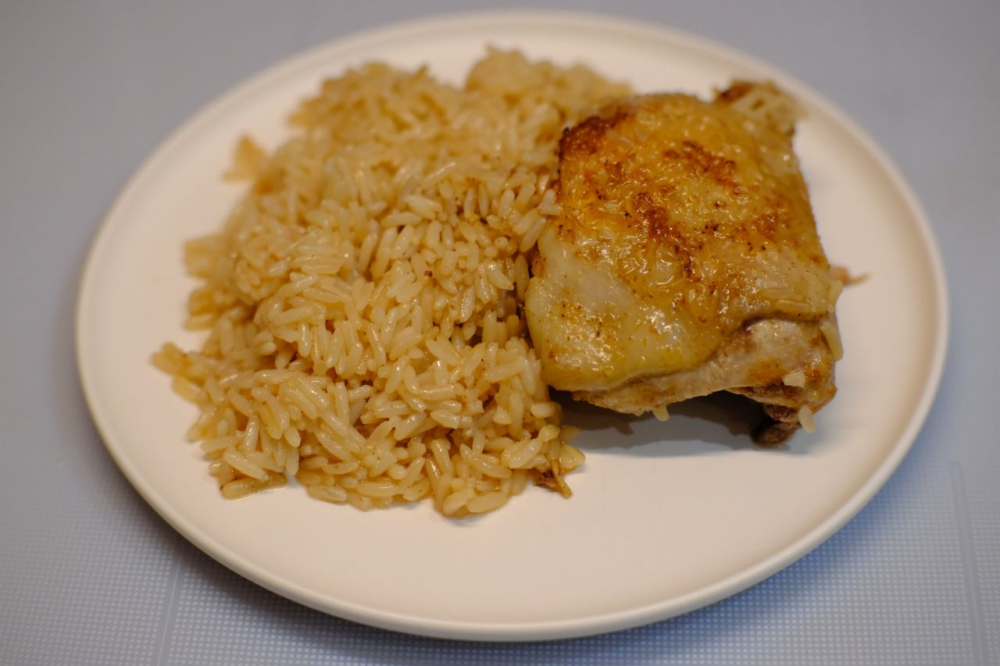

---
tags:
  - 30 минут
  - На четверых
description: Быстрый и сытный обед из риса с курицей.
---
# Рис с курицей

<figure markdown="span">
  
  <figcaption>Рис с курицей</figcaption>
</figure>

Сытный обед из риса с курицей. Почти плов, но проще.

## Инвентарь

- Глубокая сковорода 26+ см

## Ингредиенты

- Рис 240 гр
- Курица 5-6 кусков
- Вода 0.5 л
- Растительное масло для жарки
- Соль
- Любимые приправы

## Способ приготовления

1. Приготовь куски курицы. Рекомендую взять куски с кожей. Это может быть как целиковая курица, разделанная на запчасти (бедра, крылья, грудки), так и отдельно купленный набор.
1. Заранее вскипяти поллитра воды.
1. Разогрей сковороду и добавь раститеьного масла. 
1. Обжарь курицу до золотистой корочки 5-10 минут. Корочка нужна, чтобы запечатать мясо. Ну и для вкуса.
1. В обжаренную курицу добавь рис. Залей подготовленным кипятком.
1. Добавь соль и любимые приправы. Мои любимые -- паприка и сухой чеснок. Отлично подойдут шафран, куркума, карри.
1. Туши рис с курицей на медленном огне примерно 20-30 минут. Следи за уровнем воды и доливай если рис еще не готов. Мешать не надо. Как только рис станет мягким, можно выключать.

Рис впитает в себя воду вместе с жиром курицы и станет невероятно ароматным и насыщенным.

Приятного аппетита!

